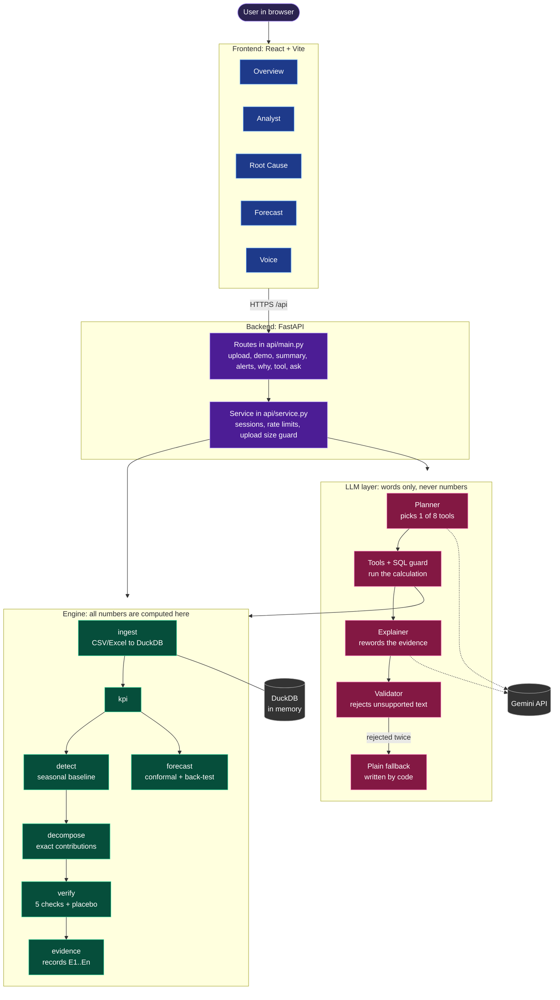
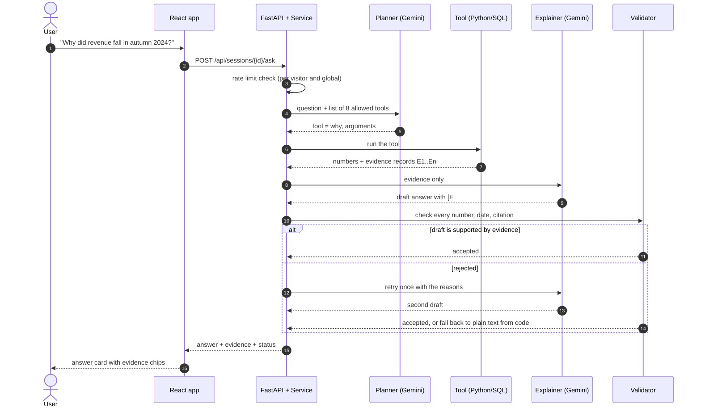

# InsightTrace

**Understand what changed. Discover why.**

InsightTrace is an AI business-intelligence app. You give it a sales table. It finds the unusual changes in your KPIs, splits each change into the groups that contributed, tests whether any group is a real cause, and explains the result with the evidence behind it.

Its main rule: **numbers come from code, not from the AI.** Every figure is calculated in Python and SQL. The AI only picks which calculation to run and rewords the result, and a checker rejects any sentence that contains a number it cannot find in the evidence. When the evidence is weak, InsightTrace says **UNKNOWN** instead of guessing.

> Live demo: _add your deployed link here_
> Video / screenshots: _add here_

---

## What you can do with it

| Tab | What it does |
|---|---|
| **Overview** | KPI cards, a chart with the range the detector *expected*, flagged unusual periods, and a list of alerts. |
| **Analyst** | Ask questions in plain English ("Which region had the highest revenue?", "Why did revenue fall in autumn 2024?"). Answers cite their evidence ([E1], [E2]...). Quick tools run the same calculations without the AI. |
| **Root Cause** | Pick an alert. See who contributed, then five checks per candidate. Verdict: **CAUSE**, **NOT A CAUSE** or **UNKNOWN**. |
| **Forecast** | Next periods with an 80% range, plus a back-test: did the range hold, and is it better than repeating last year? |
| **Voice** | Ask by voice and hear the answer read back (uses the browser's speech tools). |

### The five checks

A group is called a **CAUSE** only if it passes every check:

1. It is big enough and distinctive (not just "everything moved together").
2. It differs from the rest of the business.
3. The change started inside the window, not before it.
4. It is not a yearly repeat (seasonal pattern).
5. It is unusual for its own history.

If evidence is missing or mixed, the answer is **UNKNOWN**, and the app suggests what data to collect next. Correlation is never presented as proof.

---

## Architecture

### 1. System overview

The app has four layers. The **engine** calculates every number. The **LLM layer** only chooses which calculation to run and rewords the result. The **API** connects the browser to both. The **frontend** shows the answers.



### 2. Data pipeline (runs once when a file is loaded)

```
CSV / Excel ──► ingest ──► detect changes ──► decompose by group ──► verify (5 checks) ──► evidence records E1..En
                 (DuckDB)   (seasonal baseline)  (exact contributions)   (incl. placebo test)
```

### 3. What happens when you ask a question



### 4. Why it is built this way

- **Detection** compares each period with what the same time of year usually brings, so ordinary seasons are not alerts.
- **Decomposition** is exact: group contributions add up to the total change.
- **Verification** includes a placebo test: the same procedure is run on periods where nothing happened, to see how often it would blame something by chance.
- **Evidence records** are the only source the AI may use. Each has an id, facts with units, the checks that were run and the SQL used.
- **Validator** rejects wording that contains numbers or dates not in the cited records, overclaims ("proves"), stray citations, or sign mistakes like "fell by -5". It retries once, then falls back to a plain summary written by code.
- **Analyst** can only use 8 fixed tools (KPI value, breakdown, trend, contributors, alerts, why, forecast, read-only SQL). The SQL tool accepts a single `SELECT` on one table and blocks everything else.
- **Forecast** uses seasonal methods with conformal ranges and walk-forward validation, and reports `LOW_CONFIDENCE` when it does not beat a simple baseline.

---

## Run it on your computer (Windows)

You need Python 3.12 and Node.js 20 or newer.

**Backend**

```powershell
cd InsightTrace
python -m venv .venv
.venv\Scripts\activate
pip install -r requirements.txt
copy .env.example .env        # then open .env and paste your Gemini key
uvicorn api.main:app --port 8000
```

**Frontend** (in a second terminal)

```powershell
cd InsightTrace\frontend
npm install
npm run dev
```

Open http://localhost:5173. Use **Synthetic business** or **Superstore** on the Home page to load a demo without any file.

The AI is optional. Without `GEMINI_API_KEY`, Overview, Root Cause, Forecast and the Analyst's Quick tools still work. Typed questions and Voice need the key. Get a free key from Google AI Studio and keep it in `.env` only. `.env` is ignored by git.

**Tests**

```powershell
pytest tests/ -q              # backend and engine
cd frontend; npm test         # frontend logic
python -m bench.run_bench --seeds 1,2,3 --no-demo     # accuracy check on generated data
```

---

## Settings (environment variables)

| Name | Where | Meaning |
|---|---|---|
| `GEMINI_API_KEY` | backend | Key for the AI. Never commit it. |
| `GEMINI_MODEL` | backend | Model id to use (see `python -m llm.client --list-models`). |
| `LLM_MODE=off` | backend | Turn the AI off completely. |
| `CORS_ORIGINS` | backend | Comma-separated website addresses allowed to call the API (your frontend's address). |
| `MAX_UPLOAD_MB` | backend | Largest upload accepted (default 25). |
| `VITE_API_URL` | frontend | Address of the backend when deployed. Empty in development (the dev server forwards `/api`). |

---

## Project layout

```
api/        FastAPI layer (service.py = logic, main.py = routes)
engine/     ingest, KPIs, detect, decompose, verify, evidence, forecast
llm/        Gemini client, prompts, validator, analyst tools, SQL guard
bench/      synthetic data generator and the accuracy benchmark
data/       demo files (synthetic business, Superstore) and the answer key
tests/      backend tests
frontend/   React + Vite app (src/lib = tested logic, src/components, src/pages)
docs/       design notes
```

---

## Built with

Python, pandas, DuckDB, FastAPI, React, Vite, Gemini (backend only), pytest.
